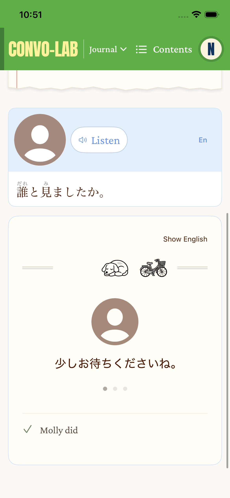

# Illustrated Journal waiting screen

The Journal now uses the desktop illustration deck instead of a spinner while
checking meaning and preparing feedback, including conversation answers. Both
original desktop atlases and all 40 crop regions are retained; PNG is used in the
iOS asset catalog for native image decoding. Source: `convo-lab` commit `e170f346`,
`client/src/features/journal/JournalThinkingOrnament.tsx` and
`journalThinkingIllustrations.ts`.

Three illustrations fade on staggered 3/6/9-second initial turns, then rotate every
nine seconds. The dots use the desktop's 2.85-second timing. Reduced Motion uses
static illustrations and dots; scene inactivity pauses animation updates. Existing
saved-answer, English toggle, delayed-message, and submission behavior are retained.

Validation: three unit tests cover all 40 bundled crops, staggered timing, and
non-repeating phrases. The clarification UI test completes its two questions,
checks saved-answer visibility with English hidden, and reaches the corrected
reply. All four tests passed on iPhone 16e / iOS 26.2.

